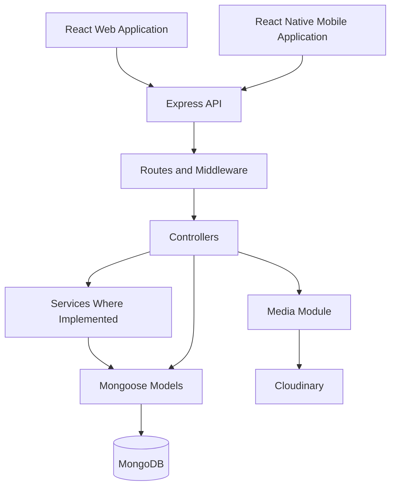

# MahaaFix

### A service-management platform built around reliable workflows, work records, and trust.

MahaaFix is a full-stack application being developed to make home-service work more structured, trackable, and accountable for customers and workers.

Instead of treating a service request as a simple call or chat, MahaaFix represents it as a structured workflow involving authentication, worker assignment, job progress, estimates, completion, verification, work records, and feedback.

The long-term vision is to build a proof-driven service platform where completed work and a worker's professional history help customers make more informed decisions.

**Project status: Active development.** The current focus is improving the correctness, consistency, and reliability of the core application before expanding the product.

**Repository:** [mahaanandareddy200611-droid/MahaaFix](https://github.com/mahaanandareddy200611-droid/MahaaFix)

---

## Table of Contents

- [Overview](#overview)
- [Key Features](#key-features)
- [Job Lifecycle](#job-lifecycle)
- [Architecture](#architecture)
- [Engineering Highlights](#engineering-highlights)
- [Technology Stack](#technology-stack)
- [Repository Structure](#repository-structure)
- [API Overview](#api-overview)
- [Getting Started](#getting-started)
- [Environment Configuration](#environment-configuration)
- [Running the Applications](#running-the-applications)
- [Testing and Quality](#testing-and-quality)
- [Development Roadmap](#development-roadmap)
- [Security Notes](#security-notes)

---

## Overview

MahaaFix currently contains three application areas:

| Application | Purpose |
|---|---|
| Backend API | Authentication, authorization, job management, work records, and persistence |
| Web frontend | Browser-based interface built with React |
| Mobile frontend | Mobile application built with React Native and Expo |

The project follows a backend-first development approach, with an emphasis on understanding how requests move through the application, how business rules are enforced, and how changes are persisted.

## Key Features

### Authentication and Users

- User signup and login.
- JWT-based authentication.
- Password recovery using an OTP workflow.
- Authenticated profile access.
- Role-based and resource-specific authorization checks.

### Job Management

- Create and retrieve service jobs.
- View jobs and jobs associated with the current user.
- Assign workers to jobs.
- Accept or reject assigned work.
- Update job status and progress.
- Submit estimates and process customer approval.
- Record completion, verification, and rework requirements.

### Worker Availability

- Worker online and offline operations.
- Worker heartbeat endpoint.
- Retrieval of online workers.

### Work Records

- Create and retrieve work records.
- Update and delete records.
- Add reviews and comments.
- Maintain a record of service-related work.

### Media and Backend Utilities

- File-upload infrastructure using Multer and Cloudinary.
- Request validation using Joi.
- Authentication, role checks, and job-access middleware.
- Centralized handling for unmatched routes and application errors.
- Idempotency middleware on selected mutation endpoints.

These capabilities describe the current codebase. Individual workflows and their edge cases continue to be tested and improved; the feature list should not be interpreted as a claim that every operation is production-ready.

---

## Job Lifecycle

Jobs are the central workflow in MahaaFix.

The current implementation supports the following general sequence:

**Create → Assign → Accept or Reject → Checking → Estimate Submission → Approval → Work Completion → Verification**

A job can also enter a rework-required path when additional work is necessary.

The backend provides separate operations for these transitions so that progress is managed through API requests rather than being represented only by frontend state.

The permitted transitions, responsible users, and validation rules remain part of the ongoing correctness and reliability work.

---

## Architecture

The application uses an Express backend between the client applications and the database.



### Request Flow

A typical protected API request follows this pattern:

1. The client sends an HTTP request.
2. Express matches the request to a mounted route.
3. Middleware performs authentication, authorization, validation, or resource-access checks as required.
4. The controller processes the request and calls a service where the module uses one.
5. Mongoose interacts with MongoDB.
6. The backend returns a response to the client.
7. Errors are passed through the application's error-handling pipeline.

The exact sequence depends on the route. Not every module uses a separate service layer, and middleware ordering is important to the behavior of each endpoint.

---

## Engineering Highlights

MahaaFix is being developed with an emphasis on backend correctness rather than CRUD operations alone.

### 1. Authentication and Authorization

Authentication identifies the caller. Authorization determines which operations that caller may perform.

The backend contains middleware for authentication, administrative access, worker access, assigned-worker checks, job-participant access, and loading job resources.

These checks help enforce workflow rules at the API layer instead of relying exclusively on the frontend.

### 2. State-Driven Workflows

Job operations are represented by distinct API endpoints for the stages of a service request.

This provides a foundation for checking allowed transitions, controlling access to operations, and ensuring that clients cannot simply declare that a job has reached a particular stage without passing through the relevant backend logic.

### 3. Request Validation and Error Handling

Joi validators are used for selected request inputs. The application also registers centralized middleware for unmatched routes and application errors.

This provides a common foundation for rejecting invalid input and producing consistent HTTP error responses.

### 4. Idempotency

The backend includes idempotency middleware on selected mutation routes, including job creation and other operations.

The purpose of idempotency is to help prevent repeated delivery of the same logical request from causing duplicate effects.

The implementation is still part of the reliability work. Transaction boundaries, request-hash validation, replay behavior, concurrent requests, failure recovery, and consistent integration across mutation routes must be validated with tests before stronger guarantees are claimed.

### 5. Modular Backend Structure

The backend separates authentication, user management, jobs, and work records into modules.

Routes, controllers, validators, middleware, models, utilities, and configuration are also separated by responsibility.

This structure makes it easier to trace how a feature works and to improve a module without unnecessarily coupling it to the rest of the application.

---

## Technology Stack

| Layer | Technologies |
|---|---|
| Backend runtime | Node.js |
| API framework | Express.js |
| Database | MongoDB |
| Object modeling | Mongoose |
| Authentication | JSON Web Tokens (JWT) |
| Password hashing | bcrypt and bcryptjs dependencies |
| Validation | Joi |
| Upload processing | Multer |
| Media storage | Cloudinary |
| Email integration | Nodemailer |
| Web application | React, Vite, React Router, Axios |
| Mobile application | React Native, Expo, React Navigation, Axios |
| Mobile storage dependencies | AsyncStorage, Expo Secure Store |
| Background-processing dependencies | BullMQ and ioredis |

BullMQ and ioredis are present in the backend dependencies. Their presence alone does not establish that a complete queue-processing, retry, or failure-recovery pipeline is operational.

Likewise, a library being installed does not mean every feature that library could support has already been implemented.

---

## Repository Structure

```text
MahaaFix/
│
├── backend/
│   ├── server.js
│   ├── package.json
│   │
│   └── src/
│       ├── app.js
│       │
│       ├── Modules/
│       │   ├── Auth/
│       │   ├── User/
│       │   ├── Job/
│       │   ├── WorkRecord/
│       │   └── media/
│       │
│       ├── infrastructure/
│       │   └── idempotency/
│       │
│       ├── middleware/
│       ├── models/
│       ├── config/
│       ├── utils/
│       └── common/
│
├── frontend/
│   ├── package.json
│   └── src/
│       ├── api/
│       ├── css/
│       ├── pages/
│       ├── routes/
│       ├── services/
│       ├── App.jsx
│       ├── App.css
│       ├── index.css
│       └── main.jsx
│
├── mobilefrontend/
│   ├── package.json
│   └── ...
│
└── README.md
```

This tree summarizes the main areas of the repository rather than listing every file. Individual modules may contain additional utilities and implementation details.

---

## API Overview

The backend mounts the following main route groups.

| Base path | Purpose |
|---|---|
| `/` | Backend health-check response |
| `/api/v1/auth` | Authentication, password recovery, and worker availability |
| `/profile` | User and profile operations |
| `/api/v1/jobs` | Job creation, assignment, retrieval, and lifecycle transitions |
| `/api/v1/work` | Work records, reviews, and comments |
| `/api/v1/Media` | Media-related operations |

### Authentication

Base path: `/api/v1/auth`

| Method | Endpoint | Purpose |
|---|---|---|
| POST | `/signup` | Create an account |
| POST | `/login` | Authenticate a user |
| POST | `/forget-password` | Initiate password recovery |
| POST | `/verify-reset-otp` | Verify a password-reset OTP |
| POST | `/reset-password` | Reset the password |
| POST | `/online` | Change worker availability |
| POST | `/heartbeat` | Update worker heartbeat |
| POST | `/offline` | Change worker availability to offline |
| GET | `/online-workers` | Retrieve online workers |

The authentication and password-recovery endpoints use the validation middleware defined in the authentication module. Worker availability endpoints have their own authentication and middleware requirements.

### Jobs

Base path: `/api/v1/jobs`

| Method | Endpoint | Purpose |
|---|---|---|
| GET | `/` | Retrieve jobs |
| GET | `/my-jobs` | Retrieve jobs associated with the current user |
| POST | `/create` | Create a job |
| GET | `/:id` | Retrieve a job |
| POST | `/:id/assign` | Assign a worker |
| PATCH | `/:id/accepted` | Accept assigned work |
| PATCH | `/:id/reject` | Reject assigned work |
| PATCH | `/:id/status` | Update job status |
| PATCH | `/:id/checking` | Record the checking stage |
| PATCH | `/:id/EstimateSubmitted` | Submit an estimate |
| PATCH | `/:id/Approval` | Process estimate approval |
| PATCH | `/:id/WorkCompleted` | Record work completion |
| PATCH | `/:id/verified` | Mark work as verified |
| PATCH | `/:id/ReworkRequired` | Record a rework requirement |

These paths reflect the current route definitions, including their existing capitalization. They may be normalized in a future API revision, but clients must use the paths currently implemented.

Job routes apply different combinations of authentication, validation, resource loading, role checks, and job-access middleware depending on the operation.

### Work Records

Base path: `/api/v1/work`

| Method | Endpoint | Purpose |
|---|---|---|
| GET | `/allWorkRecords` | Retrieve publicly available work records |
| POST | `/WorkRecord` | Create a work record |
| GET | `/work-records` | Retrieve the authenticated worker's work records |
| GET | `/work-records/:id` | Retrieve a specific work record |
| PATCH | `/work-records/:id` | Update a work record |
| DELETE | `/work-records/:id` | Delete a work record |
| POST | `/work-records/:id/review` | Add a review |
| PATCH | `/work-records/:id/review/update` | Update a review |
| POST | `/work-records/:id/comment` | Add a comment |

The media route group is mounted at `/api/v1/Media`; consult its router for the exact upload endpoints and request formats.

For protected endpoints, the authentication middleware expects a bearer token in the `Authorization` header:

```http
Authorization: Bearer <your_jwt_token>
```

Selected mutation routes use idempotency middleware. Where required, send an `Idempotency-Key` header with a stable, unique key for the logical operation. Refer to the current middleware and route definitions for the exact requirements.

---

## Getting Started

### Prerequisites

Install the following:

- Node.js and npm.
- MongoDB, either locally or through a hosted deployment.
- Cloudinary credentials if you are exercising the media-upload integration.
- SMTP credentials if you are exercising email-dependent workflows.

Some transaction-backed operations may require a MongoDB deployment that supports transactions.

### 1. Clone the Repository

```bash
git clone https://github.com/mahaanandareddy200611-droid/MahaaFix.git
cd MahaaFix
```

### 2. Install Backend Dependencies

```bash
cd backend
npm install
```

Create a `.env` file inside the `backend/` directory. Configure at least the variables shown in the next section.

### 3. Start the Backend

```bash
node server.js
```

For development with Nodemon:

```bash
npx nodemon server.js
```

The server connects to MongoDB before starting the HTTP listener.

### 4. Verify the Backend

With the backend running, make a request to:

```http
GET http://localhost:5000/
```

Example using curl:

```bash
curl http://localhost:5000/
```

Expected response:

```text
MahaaFix Backend Running 🚀
```

The port in the example assumes `PORT=5000` in the backend environment.

---

## Environment Configuration

Create `backend/.env` with the required configuration:

```dotenv
PORT=5000
MONGO_URL=your_mongodb_connection_string
JWT_SECRET=replace_with_a_secure_random_secret

frontend_url=http://localhost:5173
```

These names reflect the current backend's configuration for the port, MongoDB connection, JWT verification, and frontend origin.

Additional variables may be needed for media uploads and email workflows. Use the exact environment-variable names read by their respective configuration files.

**Important:** Do not commit real credentials, database passwords, tokens, or API secrets to GitHub.

If you change the web application's port or origin, update the backend's `frontend_url` configuration accordingly. If you change the backend's port, make sure the frontend and mobile API clients use the correct backend address.

---

## Running the Applications

### Web Frontend

Open a new terminal from the repository root:

```bash
cd frontend
npm install
npm run dev
```

The Vite development server normally starts at:

```text
http://localhost:5173
```

Use the actual URL printed by Vite if it selects a different port.

The web application's API client must point to the backend address. Check the existing files under `frontend/src/api/` and `frontend/src/services/` for the current API configuration before introducing or renaming environment variables.

Available frontend quality commands:

```bash
npm run lint
npm run build
```

### Mobile Frontend

Open another terminal from the repository root:

```bash
cd mobilefrontend
npm install
npm start
```

Expo will display the available development options in the terminal.

For a physical Android or iOS device, configure the mobile API client to use an address reachable from that device. The device's `localhost` is not the same as your development computer's `localhost`.

The mobile package also defines these commands:

```bash
npm run android
npm run ios
npm run web
```

Run the command supported by your development environment.

---

## Testing and Quality

Reliability work is an important part of MahaaFix's development.

### Frontend

The web frontend currently provides lint and build commands:

```bash
cd frontend
npm run lint
npm run build
```

These checks help catch linting problems and frontend build errors. They do not replace application-level or end-to-end testing.

### Backend

The current backend package still contains a placeholder test script. A complete automated backend test suite should be added before the project is considered production-ready.

Important areas for automated tests include:

- Signup, login, token validation, and authorization.
- Customer, worker, and administrative access rules.
- Job creation, assignment, and permitted state transitions.
- Invalid input and error-response behavior.
- Work-record ownership, reviews, and comments.
- Idempotency behavior under duplicate and concurrent requests.
- Transaction failures and rollback behavior.
- Recovery after partial failures in asynchronous workflows.

### Reliability Engineering

The backend includes idempotency middleware and dependencies associated with queue-based processing. These components require integration tests to demonstrate the guarantees they are intended to provide.

The presence of an implementation, model, or dependency should not be treated as proof of complete reliability under concurrency, retries, crashes, or network failures.

---

## Development Roadmap

The immediate goal is to make the existing application work correctly across its complete request lifecycle before expanding the product.

### Current Engineering Priorities

1. Verify job creation and transaction-backed idempotency.
2. Expand and test consistent mutation handling across relevant routes.
3. Validate transaction boundaries, duplicate-request handling, and concurrency behavior.
4. Complete outbox processing and background-job integration where required.
5. Add automated backend integration tests and failure-recovery tests.
6. Improve observability, security, and deployment readiness.
7. Continue integrating and validating the web and mobile applications against the API.

### Long-Term Product Direction

MahaaFix aims to develop toward a trust-focused service platform with:

- Verifiable records of completed work.
- Stronger worker profiles and professional histories.
- Better customer visibility into job progress.
- Evidence-backed service workflows.
- More dependable handling of disputes and rework.
- Further automation and AI-assisted service workflows as the core platform matures.

These are longer-term product goals, not a claim that every capability is already implemented.

---

## Security Notes

- Keep `.env` files and credentials out of version control.
- Use a strong, unique JWT secret.
- Do not expose database or Cloudinary credentials in client-side code.
- Treat frontend validation as a usability aid, not a replacement for backend validation.
- Apply authorization checks on the server for every protected operation.
- Validate file uploads and restrict access to resources according to their ownership and role.
- Test concurrency, error handling, and failure recovery before relying on the application for real service operations.

---

## Project Direction

MahaaFix is being built with a simple principle: **service work should be structured, trackable, and verifiable.**

The current priority is to build a reliable foundation across the client applications, backend workflows, authorization, persistence, and error handling. New features should build on that foundation rather than add complexity without verified behavior.

The project will continue to evolve as functionality is implemented, tested, and documented.

**Repository:** [https://github.com/mahaanandareddy200611-droid/MahaaFix](https://github.com/mahaanandareddy200611-droid/MahaaFix)
